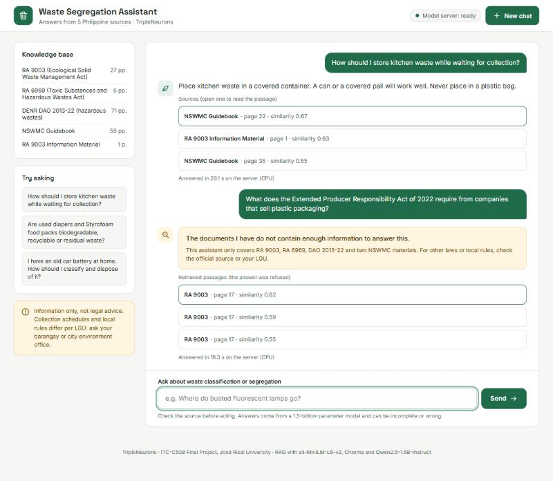
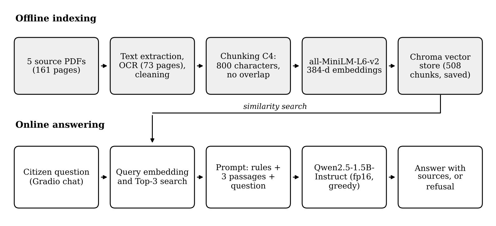

# Waste Segregation Assistant — RAG chatbot for Philippine waste classification and segregation

**Live web app:** https://tripleneurons-waste-assistant.vercel.app

A Retrieval-Augmented Generation (RAG) chatbot that answers questions on how to classify and segregate household
waste in the Philippines. It answers **only from five official Philippine sources** and shows the document and page
behind every answer, so the user can check the claim.

ITC-C508 (Deep Learning and NLP) Final Project — **TripleNeurons**, José Rizal University, Mandaluyong, Philippines:
Jude Vincent Gariando, Chris Jayson Kit Batac, Kc A. Sarmiento.

> Information only, not legal advice. Collection schedules and local rules differ per LGU: ask your barangay or
> city/municipal environment office.



## Knowledge base

| Document | Pages | Read with OCR |
|---|---|---|
| RA 9003 – Ecological Solid Waste Management Act of 2000 | 27 | 0 |
| RA 6969 – Toxic Substances and Hazardous and Nuclear Wastes Control Act of 1990 | 6 | 0 |
| DENR DAO 2013-22 – Revised procedures and standards for the management of hazardous wastes | 71 | 69 |
| NSWMC – *Solid Waste Management Made Easy* (guidebook) | 56 | 3 |
| RA 9003 information material (DENR/NSWMC) | 1 | 1 |
| **Total** | **161** | **73** |

The PDFs are in [`data/knowledge_base/`](data/knowledge_base).

## Pipeline



| Step | Choice |
|---|---|
| Text extraction | pypdf; Tesseract OCR (250 dpi) for pages with fewer than 50 characters |
| Chunking | LangChain `RecursiveCharacterTextSplitter`, **800 characters, no overlap** (C4, chosen by experiment) → 508 chunks |
| Embeddings | `sentence-transformers/all-MiniLM-L6-v2` (384-d, normalized) |
| Vector store | Chroma (persistent) |
| Retrieval | Top-3 by cosine similarity |
| Generation | `Qwen/Qwen2.5-1.5B-Instruct`, greedy decoding, max 256 new tokens, grounded system message with a fixed refusal sentence |
| Shared code | [`src/rag_core.py`](src/rag_core.py) — used by the chatbot, the evaluation and the deployed backend |

## Repository layout

```
notebooks/
  NB1_Chunking_Experiments.ipynb   document processing + OCR, chunking experiment (C1–C5), decision rule
  NB2_RAG_Chatbot.ipynb            final index, retrieval + generation, Gradio chatbot
  NB3_Evaluation.ipynb             RAG vs no-RAG answers on the 20-question test set, scoring, results
  NB4_Chat_Interface.ipynb         custom Gradio Blocks interface loaded from the NB2 index
src/                               rag_core.py, config.json, requirements.txt (exact versions of the Colab run)
backend/                           app.py (Gradio app + /ask API), saved Chroma index, chunks — deployed on AWS EC2
web/                               static web page (Vercel) that calls the backend with @gradio/client
data/                              knowledge-base PDFs, test_set.xlsx (20 questions + group review)
results/                           chunking, evaluation and scoring workbooks, logs, figures
docs/screenshots/                  chatbot and deployment screenshots
```

All notebooks are saved **with their outputs** from the Google Colab runs (Tesla T4) on 10 November 2026.

## How to run (Google Colab, T4 GPU)

1. **NB1**: upload the 5 PDFs and `data/test_set.xlsx` → downloads `TripleNeurons_NB1_Outputs.zip`.
2. **NB2**: upload `NB1_Outputs.zip` → Gradio chatbot + `TripleNeurons_NB2_Outputs.zip` (index, config, `rag_core.py`).
3. **NB3**: upload `NB2_Outputs.zip` → answers + scoring sheet; after scoring, upload it → evaluation results.
4. **NB4** (optional): upload `NB2_Outputs.zip` → custom chat interface with a public `gradio.live` link.

## Results

**Chunking experiment** (15 answerable questions, Top-3; decision rule fixed before the results):

| Config (size/overlap) | Chunks | Recall@3 | Hit@3 | MRR |
|---|---|---|---|---|
| C1 (400/50) | 1030 | 0.489 | 0.667 | 0.600 |
| C2 (800/100) | 529 | 0.461 | 0.667 | 0.578 |
| C3 (1200/150) | 365 | 0.539 | 0.667 | 0.522 |
| **C4 (800/0)** | **508** | **0.578** | **0.800** | **0.644** |
| C5 (800/160) | 558 | 0.456 | 0.600 | 0.556 |

**Chatbot evaluation** (20 questions: 15 answerable, 5 unanswerable; RAG vs. the same model without retrieval):

| Measure | RAG chatbot | No-RAG baseline |
|---|---|---|
| Mean score, answerable (0–1) | 0.567 | 0.300 |
| Correct / Partly correct / Incorrect | 4 / 9 / 2 | 0 / 9 / 6 |
| Correct refusals, unanswerable | 3 of 5 | 2 of 5 |
| Overall mean score | 0.575 | 0.325 |
| Grounded answers (answerable) | 12 of 15 | – |
| Mean response time on T4 | 2.09 s | 6.40 s |

Main failure modes: wrong citations and cut-off answers, retrieval misses on a scanned DAO 2013-22 table, and local
(LGU) questions answered with sample data from the guidebook. Details: `results/chatbot_evaluation.xlsx`.

## Deployment

- **Backend:** `backend/app.py` on an Amazon EC2 m7i-flex.large (CPU, Singapore), served over HTTPS. It loads the same
  `rag_core.py` and saved index; on CPU the model runs in float32, so answers can differ slightly in wording from the
  evaluated GPU run. If the saved index cannot be opened, it is rebuilt from `chunks_final.jsonl`.
- **Frontend:** `web/` is a static site on Vercel. The backend address is set in `web/config.js`.
- To run the backend locally: `pip install -r backend/requirements.txt gradio==6.31.0` then `python backend/app.py`.

## Use of generative AI

An AI assistant (Claude, by Anthropic) drafted the notebook code, the interface and deployment code, the draft test
set and reference answers, and suggested evaluation verdicts. The group ran all notebooks, reviewed the test set, and
scored the answers (Scorer 2 without AI assistance). Full disclosure is in the group's signed Final Project Integrity
and AI Usage Statement.
